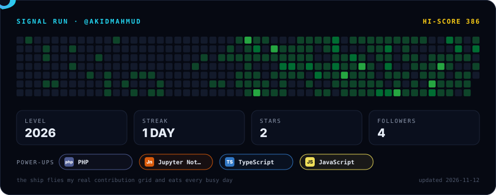
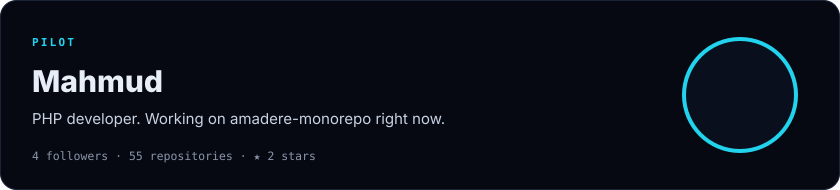
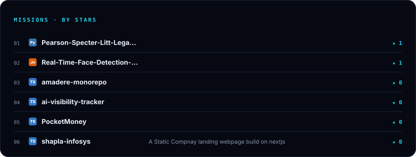
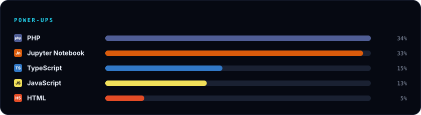
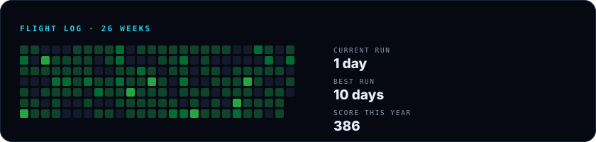

  

The level is my real contribution grid; the ship eats every busy day.

<!-- MISSIONS:START -->

[Pearson-Specter-Litt-Legal-RAG-Legal-Document-Rag](https://github.com/akidmahmud/Pearson-Specter-Litt-Legal-RAG-Legal-Document-Rag) · [Real-Time-Face-Detection-and-Classification-Using-CNN-in-Colab](https://github.com/akidmahmud/Real-Time-Face-Detection-and-Classification-Using-CNN-in-Colab) · [amadere-monorepo](https://github.com/akidmahmud/amadere-monorepo) · [ai-visibility-tracker](https://github.com/akidmahmud/ai-visibility-tracker) · [PocketMoney](https://github.com/akidmahmud/PocketMoney) · [shapla-infosys](https://github.com/akidmahmud/shapla-infosys)

<!-- MISSIONS:END -->

<a href="https://github.com/akidmahmud">GitHub</a>

